  

# Hi, I'm Namitesh Pandey 👋

### Cybersecurity enthusiast · Learning through practical projects

I'm developing my cybersecurity skills through hands-on projects focused on phishing analysis, Windows security logs, and explainable investigation workflows. I care about making security findings understandable and keeping sensitive data private.

- 🔎 **Exploring:** phishing indicators, Windows event logs, and security triage.
- 🛠️ **Building:** educational tools that run locally in the browser.
- 📚 **Learning:** how to connect warning signs with evidence and decide what to investigate next.
- 🔐 **My approach:** clear reasoning, privacy by design, and honest limitations.
- ⚙️ **Key Projects:** [Phishing Email Analyser](https://github.com/Namitesh07/phishing-email-analyser) & [Windows Security Event Log Triage Tool](https://github.com/Namitesh07/windows-security-event-log-triage-tool).

## What I'm Working Towards

Strengthening my understanding of defensive security, improving how I interpret evidence, and documenting what I learn through practical projects.

**Investigate the evidence. Understand the limits. Keep learning.**

## Technologies and Tools

Languages, platforms, and tools I use and explore.

            

## GitHub Activity

  

  

The language chart reflects repository code, rather than skill proficiency.

  

<!-- Proudly created with GPRM ( https://gprm.itsvg.in ) -->
