  

# Hi, I'm Namitesh Pandey 👋

### Cybersecurity enthusiast · Learning through practical projects

  <a href="#security-learning-focus">Learning focus</a> ·
  <a href="#featured-projects">Projects</a> ·
  <a href="#project-resources">Project resources</a> ·
  <a href="#technologies-used-in-my-projects">Technologies</a> ·
  <a href="#github-activity">GitHub activity</a>

I'm developing my cybersecurity skills through hands-on projects focused on phishing analysis, Windows security logs, and explainable investigation workflows. I care about making security findings understandable and keeping sensitive data private.

- 🔎 **Exploring:** phishing indicators, Windows event logs, and security triage.
- 🛠️ **Building:** educational tools that run locally in the browser.
- 📚 **Learning:** how to connect warning signs with evidence and decide what to investigate next.
- 🔐 **My approach:** clear reasoning, privacy by design, and honest limitations.

## Security Learning Focus

My projects give me a practical way to explore these areas:

| Area I'm exploring | What I practise | Project connection |
| --- | --- | --- |
| **Email security** | Recognising social-engineering cues, inspecting sender and link evidence, and understanding evidence gaps | Phishing Email Analyser |
| **Defensive security** | Reviewing Windows authentication and account activity, checking event context, and following supporting records | Windows Security Event Log Triage Tool |
| **Investigation and reporting** | Explaining why a rule triggered, separating findings from conclusions, and documenting what needs verification | Both projects |
| **Privacy by design** | Keeping analysis local and making the limits of each assessment visible | Both projects |

## Featured Projects

### [Phishing Email Analyser](https://github.com/Namitesh07/phishing-email-analyser)

A browser-based triage tool that surfaces visible phishing warning signs and explains how each finding contributes to a rule-based risk score.

- Inspect message text, link destinations, and available headers.
- Review evidence coverage and export a shareable summary or full evidence report.
- Analyse email content locally without uploading it to a server.

[**Explore the repository →**](https://github.com/Namitesh07/phishing-email-analyser) · [**Try the live demo →**](https://namitesh07.github.io/phishing-email-analyser/)

### [Windows Security Event Log Triage Tool](https://github.com/Namitesh07/windows-security-event-log-triage-tool)

An educational tool for reviewing exported Windows event data, spotting activity worth investigating, and tracing findings back to supporting records.

- Analyse CSV, Windows Event XML, JSON, and JSON Lines exports.
- Review authentication patterns, account changes, and process or service activity.
- Add investigation notes, export reports, and save cases to reopen later.
- Process event data locally in the browser.

[**Explore the repository →**](https://github.com/Namitesh07/windows-security-event-log-triage-tool) · [**Try the live demo →**](https://namitesh07.github.io/windows-security-event-log-triage-tool/)

> Both projects support learning and initial triage. Their findings guide further investigation; they do not prove that an email is safe or that a system is compromised.

## Project Resources

A shortcut to the documentation and release history behind each demo.

| Project | Documentation | What's changed |
| --- | --- | --- |
| **Phishing Email Analyser** | [Usage, privacy, and limitations](https://github.com/Namitesh07/phishing-email-analyser#readme) | [Releases](https://github.com/Namitesh07/phishing-email-analyser/releases) |
| **Windows Event Log Triage** | [Input formats](https://github.com/Namitesh07/windows-security-event-log-triage-tool/blob/main/docs/inputs.md) · [Detection guide](https://github.com/Namitesh07/windows-security-event-log-triage-tool/blob/main/docs/detections.md) | [Releases](https://github.com/Namitesh07/windows-security-event-log-triage-tool/releases) |

## What I'm Working Towards

Strengthening my understanding of defensive security, improving how I interpret evidence, and documenting what I learn through practical projects.

**Investigate the evidence. Understand the limits. Keep learning.**

## Technologies Used in My Projects

These badges describe the technologies behind my projects.

   

## GitHub Activity

  

  

The language chart reflects repository code, rather than skill proficiency.

  

<!-- Proudly created with GPRM ( https://gprm.itsvg.in ) -->
